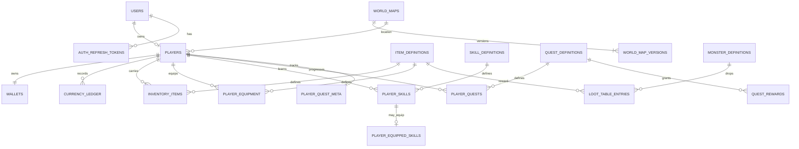

# BE domain and data model V1

**Status:** Baseline for implementation planning. This document records the observed entities, keys, relationships, and invariants before any schema migration.

**Target:** `tutien_pixel_be`, the MySQL-backed BE serving `D:\Setup\mine\tutien_pixel`.

## 1. Modeling sequence

The project follows this order before adding persistence or changing an API:

1. Trace FE requests, legacy persisted state, and use cases; record canonical names and aliases.
2. Identify domain entities, aggregates, ownership, lifecycle, and transient runtime state.
3. Define each entity's canonical fields, types, required/optional rules, primary key, business key, and derived fields.
4. Define cardinality, foreign keys, unique constraints, deletion policy, and the queries that must join the entities.
5. Record invariants and transaction/idempotency boundaries.
6. Draw the ERD and map it against the existing schema.
7. Decide migration/backfill and API compatibility; only then edit DDL and repositories.

The reference workflow's Node 20, TypeScript, PostgreSQL, Prisma, Redis, and Zod are examples, not project requirements. The current project is Node 24, CommonJS JavaScript, Express, Socket.IO, and MySQL/InnoDB. This model retains that stack.

## 2. Evidence and boundaries

- The legacy state store persists `users[]` and `players[]`; it validates one player per user and stores the player as a whole JSON object. Legacy IDs are numeric.
- The FE contract uses `user.id`, `player.id`, catalog item IDs, skill codes, quest IDs, world codes, inventory stacks, equipment slots, and player quest snapshots.
- The BE schema already normalizes player-owned wallet, inventory, equipment, learned/equipped skills, and quest progress into separate tables.
- Current BE creates string IDs such as `usr_<uuid>` and `plr_<uuid>`; SQL columns are `VARCHAR(64)`.
- FE compatibility fields `xu`, `jsonIventory`, `trangBi`, `equip_slot`, `mapId`, `tuViHienTai`, and `tangTuVi` are DTO projections/aliases. They are not separate persisted entities.

Separate data by lifecycle:

| Data class | Examples | Persistence owner |
|---|---|---|
| Identity and player progress | user, player, wallet, inventory, equipment, skills learned, quest progress | MySQL, durable |
| Game definitions | item, skill, realm/root, monster/loot, quest, NPC, world map | Versioned catalog source; admin-editable definitions must have one durable source of truth |
| Runtime session | socket presence, monster HP/target, drop position, cooldown, temporary buffs | Process memory today; shared runtime required before multi-instance deployment |
| API projection | derived stats, combat power, localized labels, FE aliases | Computed by application/DTO mapper; do not store as independent truth |

## 3. Entity and table dictionary

`Current` means a corresponding table exists in `schema.sql`. `Target` means the model needs a dedicated definition/version table or a constraint that the current schema does not yet provide.

| Entity | Current/target table | Primary/business key | Canonical attributes and relationships |
|---|---|---|---|
| User account | `users` (Current) | PK `id`; unique normalized `username` | `password_hash`, `role`, `status`, timestamps. One account owns one player in the current contract. |
| Refresh session | `auth_refresh_tokens` (Current) | PK `id`; unique `token_hash` | `user_id` FK → users, expiry, revoked time, replacement hash, created time. Store only token hashes. |
| Player | `players` (Current) | PK `id`; unique `user_id` FK → users; current schema also makes `name` globally unique | `name`, `gender`, `linh_can`, `realm_code`, `realm_stage`, `tu_vi`, `tu_vi_linh_can`, `hp/mp`, stats, unspent points, `map_code`, fractional `x/y`, `version`. `xu` belongs to Wallet. |
| Wallet | `wallets` (Current) | PK/FK `player_id` → players | Balances and version. Current balances are `xu` and `linh_thach`; API `player.xu` is a projection. |
| Currency transaction | `currency_ledger` (Current) | PK `id`; unique idempotency key per player | Player, reason, signed amount, resulting balance, timestamp. Target adds `currency_code` and a reference to the use case so multiple wallet currencies remain distinguishable. Append-only. |
| Item definition | `item_definitions` (Target) | PK `item_code` | Type, stack limit, prices, required realm, effects/stats, active/version. Stable searchable fields are columns; optional presentation/effect detail may be JSON. Current item seed/override data has no relational master row. |
| Inventory stack | `inventory_items` (Current) | PK `id`; unique `(player_id,item_code)` | Player FK, item definition FK, quantity, slot, version. This models stackable catalog items; it does not model per-instance random rolls. |
| Equipment slot | `player_equipment` (Current) | Composite PK `(player_id,slot)`; unique `(player_id,item_code)` | Player FK, item definition FK, version. Equipped item is removed from its inventory stack in the same transaction. |
| Skill definition | `skill_definitions` (Target) | PK `skill_code` | Root, required realm/stage, category/target type, MP cost, cooldown, range, effects, version/status. |
| Learned skill | `player_skills` (Current) | Composite PK `(player_id,skill_code)` | Player FK, skill definition FK, learned timestamp. |
| Equipped skill slot | `player_equipped_skills` (Current) | PK `(player_id,slot)`; unique `(player_id,skill_code)` | Player FK and skill FK. Target also adds composite FK `(player_id,skill_code)` → `player_skills`, ensuring only learned skills can be equipped. |
| Root/realm definitions | `root_definitions`, `realm_definitions`, `realm_stages` (Target) | `root_code`, `realm_code`; unique realm order; composite `(realm_code,stage_no)` | Player references stable codes, not display names or stage array positions. Player realm/stage can reference the composite stage key. |
| Quest definition | `quest_definitions` (Target) | PK `quest_id` | Category, text, target/event type, optional target item/monster/NPC codes, initial status, version/status. |
| Quest reward | `quest_rewards` (Target) | Composite `(quest_id,reward_no)` | Quest FK, reward kind, amount, optional item code. Reward item references item definitions. |
| Player quest progress | `player_quests` (Current) | Composite PK `(player_id,quest_id)` | Player and quest FKs, status, progress, version. Target progress must be validated against the current quest definition. |
| Player quest meta | `player_quest_meta` (Current) | PK/FK `player_id` | Revision and tracked quest. Target adds composite FK `(player_id,tracked_id)` → `player_quests(player_id,quest_id)`. |
| World map | `world_maps` (Target; current `admin_worlds`) | PK `map_code` | Stable identity/status/current publication metadata. Player `map_code` references a published map. |
| World map version | `world_map_versions` (Target; current JSON is in `admin_worlds`) | Composite PK `(map_code,version)` | Immutable map document, status, actor, timestamp. Keep the large tile/layer grid as a versioned JSON aggregate; do not create one DB row per tile. Validate portal target map codes and coordinates before publish. |
| NPC definition/placement | `npc_definitions` and map-version placement (Target) | PK `npc_code`; placement key within `(map_code,version)` | Separate reusable NPC identity/dialogue from its location on a map. Map placement can remain in the version document if it is not queried independently. |
| Monster/loot definition | `monster_definitions`, `loot_tables`, `loot_table_entries` (Target) | Monster code; loot table code; composite table/item key | Monster combat definition and its loot entries reference item definitions. Runtime HP/target/respawn are not stored here. |
| Admin content override | `admin_content_records` (Current) | Composite PK `(collection_name,record_id)` | JSON, tombstone, version, actor. Current generic records do not create FKs to item/skill/quest definitions. Replace or constrain this storage for mutable catalogs before treating it as the runtime source of truth. |
| Skill VFX profile | `skill_vfx_profiles` (Current) | PK `skill_code` | Profile JSON and actor/time. Target FK to `skill_definitions` and an audited version strategy. |
| Idempotent command | `idempotency_keys` (Current) | Current PK `(user_id,request_id)` | Store use-case scope, payload fingerprint, committed result, and retention metadata. Reusing a key with a different intent must conflict. |
| Player action history | `player_action_ledger` (Current) | PK `id`; unique player/idempotency key | Progression/equipment/skill before/after audit. Keep separate from the currency ledger because their audit semantics differ. |
| Loot claim | `loot_pickups` (Current) | PK `drop_id` | Player FK, item code, quantity, timestamp. Add item FK and retention policy; drop position/HP/expiry remain runtime state. |
| Admin audit event | `admin_audit_logs` (Current) | PK `id` | Actor, action, resource, before/after, request ID, timestamp. Do not cascade-delete audit history with an account. |

## 4. Relationship diagram

Solid relationships are durable relational joins in the target model. Definitions marked `Target` are not all represented by foreign keys in the current DDL.



## 5. Canonical keys and join paths

- Primary IDs identify rows; business codes identify definitions. Never join on a display name or a FE alias.
- Canonical codes are `item_code` (current catalog `item.id`), `skill_code` (`skill.code`), `quest_id`, `root_code`, `realm_code`, `monster_code`, and `map_code`. `maDo`, `skill.id`, `mapId`, and localized names are compatibility/display fields; normalize them at the API boundary.
- The token subject is `users.id`. Private requests resolve `players.user_id = users.id`; client `userId` never selects an owner.
- Player snapshot read joins by `player_id`: `players` + `wallets` + `inventory_items` + `player_equipment` + `player_skills` + `player_equipped_skills`. Definition tables decorate item/skill codes into DTOs after the authoritative rows are loaded.
- World join resolves `players.map_code` → the published `world_maps` version, then keeps socket presence/monster runtime in memory. Persist only the player location on the defined checkpoint path.
- Quest snapshot joins `(player_id,quest_id)` progress to `quest_definitions`, `quest_rewards`, and `player_quest_meta`; the response labels/objective are projections from the definition.
- Shop/use/equip/quest reward follow FK codes from player-owned rows to definitions; stale or disabled definitions must be rejected or handled by an explicit archival policy.

## 6. Aggregate invariants and transaction boundaries

| Operation | Rows changed together | Required invariant |
|---|---|---|
| Create player | player, wallet, initial ledger, learned/equipped skills, initial quest rows/meta | One player per owner; all initial state is complete or none is committed |
| Buy/sell/use item | player lock, wallet, inventory stack, currency ledger where relevant, idempotency result | Balance/stack/capacity valid; response reflects committed state; retry cannot repeat the mutation |
| Equip/unequip | player lock, inventory stack, equipment slot, action ledger, idempotency result | One item cannot be both in inventory and equipped; one item per slot; previous item return fits capacity |
| Learn/equip skill | player lock, learned rows, loadout rows, action ledger, idempotency result | Equipped set is a subset of learned set and obeys slot/category/root rules |
| Accept/track/claim quest | player lock, player quest rows/meta, wallet, inventory, ledgers, idempotency result | Progress/status/reward/meta remain consistent; reward cannot be granted twice |
| Admin publish | map/content version and audit row | Only validated versions become published; prior versions remain recoverable |

The Socket.IO event is published after the database commit. If event delivery must survive a process crash, add an outbox in the same transaction; do not hold a DB transaction open while emitting or waiting on a socket.

## 7. Existing-schema gaps to resolve

The current schema already has a sound start for account/player-owned state, but it is not yet a complete entity model:

1. Player rows have FKs only to users. `realm_code`, `linh_can`, `map_code`, item codes, skill codes, and quest IDs have no master-table FK because definitions are seed/JSON based.
2. Inventory has unique `(player_id,item_code)` but no unique `(player_id,slot)` or database check for positive quantity. Enforce both in the DB when supported and keep service validation.
3. `player_equipped_skills` is not constrained to `player_skills`; the service currently enforces this. Add the composite FK.
4. `player_quest_meta.tracked_id` can point at no quest row. Add a composite FK or enforce and reconcile it transactionally.
5. Wallet has two currencies, while `currency_ledger` has no currency column. Add `currency_code` before mutating more than one balance through the ledger.
6. `players.max_hp/max_mp` are persisted while `derivedStats.maxHp/maxMp` are recalculated from stats/equipment. Choose one canonical rule and update current vitals/limits in the same transaction to prevent drift.
7. `admin_worlds` stores only the latest map document/version; `admin_audit_logs` contains before/after JSON but there is no immutable version entity for reliable publish/rollback.
8. `admin_content_records` is generic JSON. Admin quest overrides are not consumed by `QuestService`, which uses static `QUEST_DEFINITIONS`; NPCs also exist inside world documents and the generic `npcs` collection. Choose one owner for each definition before adding FKs or claiming edits are live.
9. Legacy file persistence uses numeric IDs and whole-player JSON; BE uses string IDs and normalized rows. No importer/mapping currently connects the two. Migration must explicitly map user/player IDs and split inventory/equipment/skills/quests without trusting client snapshots.
10. Current DDL makes player name globally unique; the legacy JSON validator only proves non-empty name/ID/owner uniqueness. Keep the BE rule for compatibility until the product contract explicitly changes it.

## 8. Proposed module ownership after the model is accepted

Keep the modular monolith, organized by domain ownership rather than by a global `models/` or `repositories/` dumping ground:

```text
src/
  bootstrap/                 # composition root and app lifecycle
  shared/                    # errors, validation primitives, transaction runner
  modules/
    identity/                # User, refresh sessions, authentication
    player/                  # Player, stats, progression, vitals
    economy/                  # Wallet, ledger, shop and inventory transactions
    equipment/                # Equipment slot rules and inventory transfer
    skills/                   # Skill definitions, learned set and loadout
    quests/                   # Definitions, progress, events and rewards
    world/                    # Map versions, portals, placements and publication
    catalog/                  # Item/realm/root/monster definitions and lookup ports
    admin/                    # Admin use cases, authorization and audit
    realtime/                 # Socket protocol/gateway, runtime, command use cases
```

Each module owns its application use cases, domain rules, repository port, MySQL adapter, and transport DTO/mapping where applicable. Cross-module writes go through an application port/use case or an explicit unit-of-work transaction, not another module's SQL. Keep HTTP/socket handlers thin. No ORM or DI container is required to achieve these boundaries.

## 9. Decisions and migration order

These defaults are grounded in the current FE contract and BE code:

- One user owns at most one player; `players.user_id` remains unique.
- `item_code`, `skill_code`, `quest_id`, and `map_code` are stable canonical identifiers. Display names and FE aliases are not keys.
- Inventory rows represent stackable catalog items keyed by `(player_id,item_code)`. Per-instance randomized item attributes are outside the current model.
- Player names stay globally unique because the current BE schema enforces it. Legacy import must detect collisions and report them rather than silently rename accounts.
- `xu` is the only currency currently written to `currency_ledger`; add `currency_code` before recording another wallet currency.
- Versioned definitions are the target for admin-editable content. Until their runtime readers and backfill exist, the existing seed-plus-override sources remain the running implementation; an admin write is not proof that a definition affects gameplay.
- Legacy IDs are mapped by an explicit importer table/report. Never derive a new ID from a numeric legacy ID or trust FE snapshots as migration input.

Implementation order:

1. Freeze definition ownership for items, skills, quests, NPCs, and maps; ensure admin writes and gameplay reads share the same source.
2. Add typed definition/version tables and seed/backfill from the currently authoritative sources while retaining the existing API response shape.
3. Add backward-compatible constraints only after a preflight query proves existing rows satisfy them.
4. Build a repeatable importer for legacy IDs and JSON fields; record source-to-target ID mapping and collision/error reports.
5. Verify row counts, owners, inventory totals, equipment/loadout validity, quest state, and wallet/ledger reconciliation before switching the FE to the BE as the single writer.
6. Split the MySQL adapter by aggregate behind repository ports, one vertical slice at a time; preserve transaction boundaries and API/socket contracts.
7. Keep rollback snapshots and the old data read-only during the compatibility window. Consider shared runtime/Redis only after the single-instance model is stable; do not store monster ticks in the relational DB.

This phase creates the model and architecture baselines only. The next implementation slice should start with a source-of-truth decision for mutable catalog definitions, then add compatible schema and readers together; applying a migration without its backfill and runtime reader would leave stored definitions unused.
