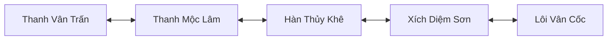

# Đánh giá gameplay và tuyến map đầu game — 2026-11-05

## Kết luận

Đã có bộ nội dung để chuẩn bị demo tuyến đầu game. Chưa thể gọi là beta hoàn chỉnh: ngân hàng hình ảnh và chỉ số lớn hơn đáng kể so với số cơ chế combat realtime BE hiện thực thi. Các đánh giá dưới đây dựa trên DB và source hiện tại; không suy từ hiệu ứng FE rằng BE đã áp dụng đúng cơ chế.

## Kỹ năng và quái

| Hạng mục | Evidence | Đánh giá |
| --- | --- | --- |
| Kỹ năng | 102 definition trong DB: 93 ACTIVE, 9 PASSIVE; không thiếu file ảnh | Ngân hàng đủ dùng để demo lựa chọn build; chưa đủ để chứng nhận 102 cơ chế hoàn chỉnh |
| Quái | 45 loại không phải boss, 1 boss; không thiếu ảnh hay lootTableId | Đã có catalog và ảnh; 12 loại mới được đưa vào tuyến map lần này |
| Damage online | `src/realtime/gameplay-service.js::combatAttack` gọi `damageMonster` một target và trả một hit | AoE trong definition/ảnh chưa tương ứng AoE damage trên BE |
| Debuff và passive | Các effect trong definition chưa được áp đầy đủ vào combat online; damageFor dùng derived stats cơ bản | Root, stun, burn, curse và passive cần vòng đời thực thi authoritative; không coi animation là bằng chứng tác dụng |
| Buff | castSkill ghi buff state; heal/restore MP thực hiện qua store; buff_spd có consumer | buff_atk/def/crit/shield… chưa được ghép đầy đủ vào damage/mitigation; cần audit riêng trước beta |
| AI | `tickMonsters` đuổi theo vector và kiểm tra ô đích | Vẫn có thể kẹt khi thả diều qua sông; chưa có A* chase/return tương xứng |
| Sinh boss | FE/BE từng clamp mọi pack tối thiểu 3 | Đã sửa: BOSS được phép 1; quái thường giữ 3–5 |
| Độ khó PvE | tickMonsters giữ HP người chơi tối thiểu 25% maxHP | Đang có bảo hộ demo; chưa đại diện gameplay có chết/phạt/hồi sinh thực tế |

## Tu vi và phá cảnh

Nguồn chuẩn online là BE MySQL, không phải nhánh offline của FE:

1. Hấp thụ STONE/ELEMSTONE: catalog item → effectFor → store.useInventoryItem → khóa player và inventory trong transaction → cộng tu_vi và trừ một vật phẩm → snapshot trả FE. Ngọc linh căn là LINDAN và cộng tu_vi_linh_can có cap riêng, không thay cho tu vi cảnh giới.
2. Quái chết hiện rơi vật phẩm và cập nhật quest; không cộng trực tiếp tu vi mỗi kill trong combatAttack. Người chơi cần hấp thụ linh thạch, hoặc nhận thưởng tu vi từ quest. Mô tả này cần giữ rõ trong hướng dẫn.
3. Ngưỡng cơ bản: `floor(1000 × 1.24^((realm.stt−1)×10 + stage−1))`. Tầng cuối nhân 1.5 để phá đại cảnh giới. Snapshot BE đã dùng threshold này; FE hiển thị theo snapshot.
4. Phá tầng cần đủ tu vi và OVR. Phá đại cảnh giới còn cần đúng `realm.danPhaCanh`; store khóa đan, tiêu hao đúng 1 viên khi mutation thành công. Cùng transaction trừ threshold, giữ tu vi dư, tăng chỉ số và cập nhật realm/stage. Đại Đế là điểm dừng hiện tại.
5. Đã sửa discrepancy: kiểm tra OVR trong store trước đây tìm trang bị từ itemCatalog tĩnh, khác catalog DB mà service dùng. Service hiện truyền catalog tin cậy xuống bước kiểm tra dưới khóa.
6. FE hiện chặn bấm lặp khi request hấp thụ/đột phá còn chờ, bắt lỗi kết nối, báo nổi khi thiếu tài nguyên, thiếu đan hoặc đã tối cao. Bấm trực tiếp đan trong túi chỉ hiện hướng dẫn; BE cũng trả lỗi dành riêng, không tiêu hao đan như thuốc.

### Nguồn vật phẩm

Trước thay đổi, cả 12 đan phá đại cảnh giới có giá mua 0 và không nằm trong bảng loot/quest gốc: progression bị chặn ở lần đại cảnh giới đầu. Đã mở đường mua cho hai lần đầu, không cho mua miễn phí:

| Vật phẩm | Tác dụng | Giá Xu |
| --- | --- | ---: |
| DAN_PHI_THANG | Luyện Thể → Khí Động | 650 |
| DAN_KHI_NGUNG | Khí Động → Ly Hợp | 2200 |
| STONE_LINH_TRUNG | Hấp thụ 600 tu vi | 100 |
| STONE_LINH_LON | Hấp thụ 1800 tu vi | 300 |

Các đan sau Ly Hợp chưa có nguồn nhận ở tuyến đầu này. Nhịp farm, tỷ lệ loot và giá hiện là cấu hình khởi đầu, chưa có số liệu playtest để chốt cân bằng.

### Điểm cần xử lý tiếp ở progression

- Retry cùng requestId sau một đột phá đã commit có thể bị service kiểm tra theo stage/tu vi mới trước khi đến dedup trong store; cần đưa replay lên trước preflight và ổn định fingerprint theo intent không có stage trong request. Chưa thay contract này trong lần tạo nội dung.
- Store đang vừa tự cộng stat gain vừa cấp unspentPoints bằng cùng ngân sách. Cần chốt đây là hai phần thưởng có chủ đích hay cộng đôi ngân sách, trước khi chỉnh cân bằng; không tự đoán để đổi dữ liệu nhân vật hiện tại.
- Cần test transaction song song, replay khi mất response, thiếu đan, tầng cuối và max realm trước khi mở alpha ngoài nhóm nội bộ.

## Bốn map đã ghi DB

| Code | Nội dung |
| --- | --- |
| alpha_thanh_moc_lam | Thanh Diệp Yêu, Thiết Nha Lang, Sa Địa Trư |
| alpha_han_thuy_khe | Thủy Linh Thảo, Băng Nha Lang, Độc Nha Lang |
| alpha_xich_diem_son | Xích Mao Trư, Dung Nham Lang, Hỏa Tinh Thảo |
| alpha_loi_van_coc | Điện Nha Lang, Lôi Linh Thảo, Thạch Bì Lang |

Mỗi map 160×120 ô, 3 NPC (hướng dẫn, shop dược sư, hộ vệ), 3 pack × 3 quái, đường chính và nhánh tới bãi, sông có lối qua, vật cản và elevation. Aggro 26 / leash 36 cho phép phát hiện và đuổi ngắn quanh bãi; không thay thế việc triển khai pathfinding BE. Tổng mới: 12 NPC, 12 bãi, 36 quái runtime khi các room được tạo. Không thêm boss vào tuyến này.

Các map PUBLISHED trong `admin_worlds`, liên kết hai chiều và có cổng mới gần spawn của map mặc định. Seed giữ các cổng cũ. Map hiện có và dữ liệu nhân vật không bị reset. Những map alpha được seed trước đó không bị ghi đè khi chạy lại; riêng nâng cấu hình bãi 14→26 chỉ áp trên record version 1 do chính actor seed sở hữu.

`scripts/seed-alpha-route.js` tạo dữ liệu có thể chạy lại, kiểm tra validateWorld, flood-fill từ spawn đến NPC/portal/tâm bãi và ảnh template trước khi ghi. Apply dùng một transaction cho các map/cổng/item, có audit actor `alpha-route-v1`. Không chạy migration/DDL.

## Evidence và vận hành

- Readback DB trước: 102 skill, 45 non-boss, 3 map; 12 đan đều chưa mua được.
- Apply thành công: `created=4`, `updatedItems=4`, `maps=4`. Readback sau: world catalog tổng 7, hai đan đầu giá 650/2200; `skillImagesMissing=[]`, `monsterImagesMissing=[]`, `monsterLootMissing=[]`.
- Lần apply kế tiếp: `created=0`, `updatedItems=0`, xác nhận không nhân đôi map/item; bốn cấu hình bãi do seed sở hữu được hoàn thiện.
- File `data/alpha-content-audit.json` ghi snapshot đánh giá mới nhất, không chứa tài khoản/token.
- Map mặc định khoảng 2.13 MB vượt max_allowed_packet 1 MB gây reset khi thêm portal. Lần lỗi đầu chưa commit. Đã tăng MySQL local lên 16 MB, lưu `C:\xampp\mysql\bin\my.ini`, có backup `my.ini.alpha-before-16m.bak`. Seed có guard kích thước packet; không tự đổi DB server config.
- Đã đọc lại symbol trực tiếp và git diff/diff --check ở FE và BE; chỉ có cảnh báo line ending. Fixture service test được bổ sung dependency listItems để tương thích contract nội bộ.
- Chưa chạy unit/build/gameplay/browser trong task này theo quy tắc mặc định của skill dev. Các kiểm tra cấu trúc dữ liệu trước khi seed và readback mutation không được coi là unit test hoặc nghiệm thu gameplay.
- BE cần khởi động lại sau cập nhật code/catalog. FE đã tăng cache version.

## Thứ tự tiếp theo trước beta

1. P0: BE combat AoE, status lifecycle, shield/buff/passive có tác dụng thật; đồng bộ hit/event với FE.
2. P1: Replay progression trước preflight, thống nhất ngân sách stat và thêm nguồn đan các cảnh giới sau.
3. P1: A* chase/return, lifecycle quái, chính sách HP bảo hộ demo và chết/hồi sinh.
4. Nghiệm thu gameplay tuyến 4 map: cảm giác đánh/di chuyển, thời gian đạt các tầng, lượng farm để mua đan, độ rõ icon/hiệu ứng.

Rollback: dùng audit before/after theo actor và version, không xóa collection hàng loạt; khôi phục riêng portal/item/map vừa tạo khi chưa có chỉnh sửa mới hơn. Source fix có thể revert từng diff; không đổi schema hay dữ liệu stat nhân vật hàng loạt.
